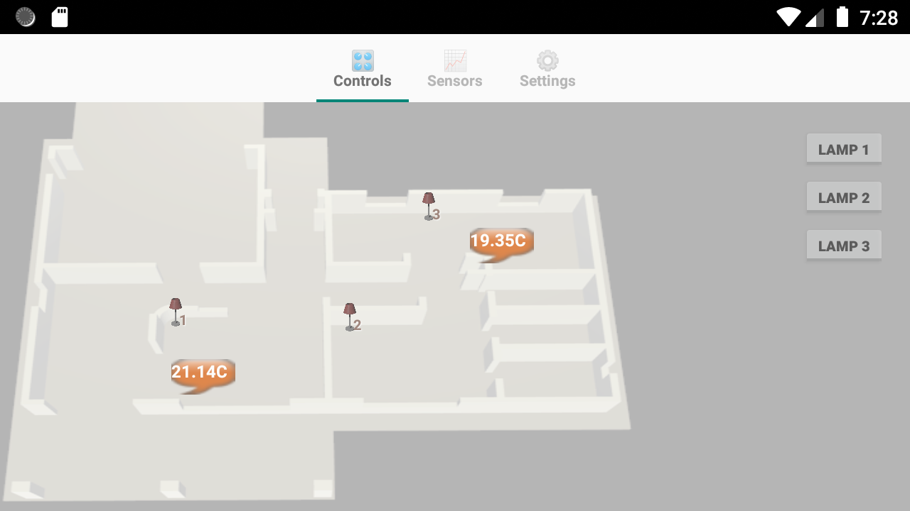
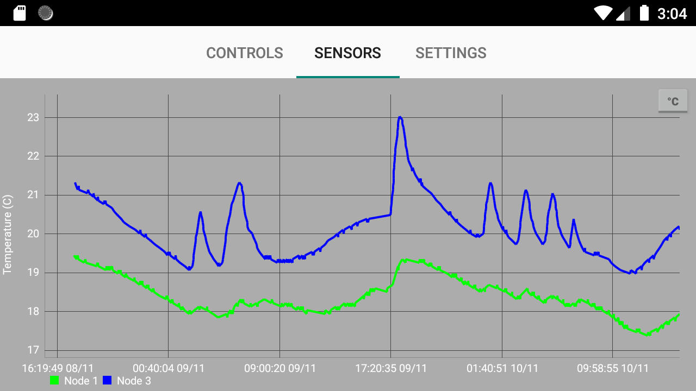
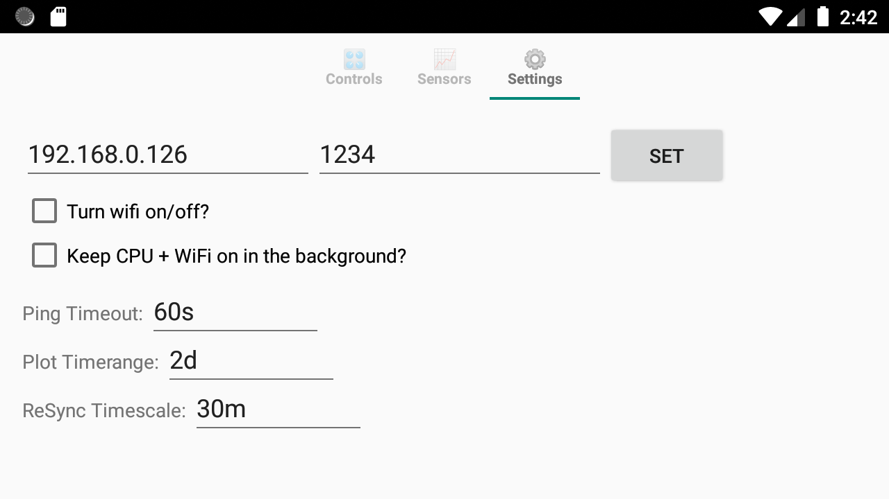

# aNaarad (aNaarad3)

[](https://developer.android.com)
[](https://kotlinlang.org)
[](https://github.com/PhilJay/MPAndroidChart)

**aNaarad** is a modern, responsive native Android client application designed for real-time smart home telemetry, multi-node sensor data acquisition, time-series plotting, and interactive device control.

The app communicates directly over local TCP sockets with a home telemetry server, providing live monitoring, historical data synchronization, and interactive floorplan controls.

---

## 📱 Tab Screens & Features

| Controls Tab | Sensors Tab | Settings Tab |
| :---: | :---: | :---: |
|  |  |  |
| **Interactive Floorplan & Switches** | **Real-Time & Historical Plotting** | **Network & Polling Configuration** |

### 1. 🎛️ Controls Tab
- **Interactive Floorplan Overlay**: Drag-and-Drop lightbulb icons and number badges together to match your physical home layout. Position coordinates persist across app restarts.
- **Device Toggles**: Single-tap lightbulb icons or right-hand toggle buttons to control lighting circuits remotely.
- **Live Sensor Speak-Bubbles**: Real-time temperature speech bubbles positioned over room locations. Single-tap any speak-bubble to toggle displayed units between **°C** and **°F** with persistent preference saving.

### 2. 📈 Sensors Tab
- **High-Performance Plotting**: Time-series telemetry plotting powered by **MPAndroidChart**.
- **Historical Data Resync**: Automatically detects data gaps greater than the configured resync timescale and backfills missing historical streams (`gethpkt`) seamlessly.
- **Rolling Window**: Automatically prunes entries older than the configured plot timerange to optimize RAM usage while maintaining a rolling history window.
- **Interactive Y-Axis Unit Switching**: Single-tap the vertical Y-axis label button (**"Temperature (C)"** / **"Temperature (F)"**) to dynamically convert on-screen plot values between °C and °F.

### 3. ⚙️ Settings Tab
- **Server Connection**: Configure target server IP address and TCP port.
- **Flexible Time Inputs**: Configure `Ping Timeout`, `Plot Timerange`, and `ReSync Timescale` using DHMS format inputs (e.g. `2d`, `1h30m20s`, `10m`, `45s`, `120`). Settings are applied live and saved persistently across app restarts.
- **Power & Network Controls**: Toggle CPU wake locks and Wi-Fi locks to ensure continuous background polling.

---

## 🛠️ Architecture & Tech Stack

- **Language**: 100% Kotlin (targeting Java 11 JVM Bytecode)
- **Target SDK**: Android 15 (API 35) \| **Min SDK**: Android 8.0 (API 26)
- **UI Architecture**: `TabLayout` + `ViewPager2` + `TabLayoutMediator`
- **Plotting Library**: `MPAndroidChart v3.1.0` with custom vertical Y-axis rendering
- **Concurrency & Sockets**: Custom non-blocking `iSleep` thread synchronization (`CountDownLatch`) and non-blocking TCP socket readers

---

## 🚀 Building & Running

### Prerequisites
- Android Studio Ladybug or later
- JDK 17 / 21

### Build Debug APK
```bash
./gradlew app:assembleDebug
```

### Build Signed Release APK
```bash
./gradlew app:assembleRelease
```
The output APK is generated at:
`app/build/outputs/apk/release/app-release.apk`

---

## 📄 License
This project is licensed under the **GNU General Public License v3.0 (GPL-3.0)** - see the [LICENSE](LICENSE) file for details.
